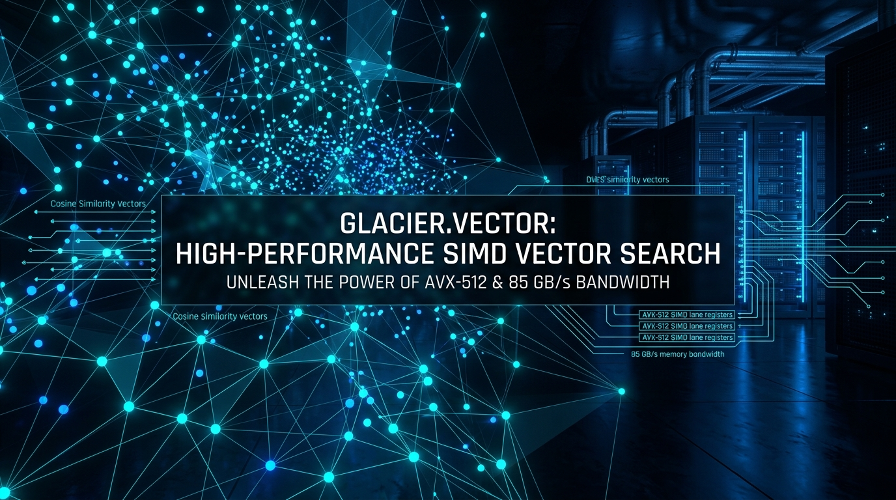

# Glacier.Vector

[](LICENSE)
[](https://dotnet.microsoft.com/)
[](https://learn.microsoft.com/dotnet/core/deploying/native-aot/)
[](https://www.nuget.org/packages/Glacier.Vector/)
[](https://www.nuget.org/packages/Glacier.Vector/)

`Glacier.Vector` is a pure C#, Native AOT-compatible (`IsAotCompatible=true`) vector search engine and quantization library for .NET 10. It provides AVX-512 / AVX2 / `Vector128` SIMD distance kernels, HNSW and IVF-PQ indexes, Hadamard/RaBitQ 1-bit rotation, pluggable RAM and disk-backed storages (`InMemoryVectorStorage`, `MmfVectorStorage`, `PagedVectorStorage`, `BinaryVectorStorage`), optional NVIDIA CUDA driver P/Invoke (`nvcuda.dll`), and an embedded MCP server (`Glacier.Vector.Host`).

Read the background write-up: [I built a zero-dependency C# vector database that saturates DDR5 RAM bandwidth](https://dev.to/iancowley/i-built-a-zero-dependency-c-vector-database-that-saturates-ddr5-ram-bandwidth-5f9a).

## Install

```bash
dotnet add package Glacier.Vector
```

## Quick Start

### In-Memory Index & Search

```csharp
using Glacier.Vector.Index;
using Glacier.Vector.Storage;

using var storage = new InMemoryVectorStorage(dimensions: 1536);
using var index = new VectorIndex(storage);

float[] docVector = new float[1536];
docVector[0] = 1.0f;
index.Add(docVector, metadata: "Greeting message");

float[] query = new float[1536];
query[0] = 1.0f;
SearchResult[] hits = index.Search(query, topK: 5);

foreach (SearchResult hit in hits)
{
    Console.WriteLine($"ID={hit.Id}, Score={hit.Score:F4}, Metadata={hit.Metadata}");
}
```

### Zero-Allocation HNSW Search & Batch GPU Scan

```csharp
using Glacier.Vector.Compute;
using Glacier.Vector.Core;
using Glacier.Vector.Index;
using Glacier.Vector.Storage;

using var storage = new InMemoryVectorStorage(dimensions: 128);
using var hnsw = new HnswVectorIndex(storage, m: 16, efConstruction: 64);

Span<SearchResult> topK = stackalloc SearchResult[10];
float[] query = new float[128];
int found = hnsw.Search(query, topK, efSearch: 64);

// Optional 2D batch scan on NVIDIA CUDA (falls back automatically when unavailable)
float[] db = new float[50_000 * 128];
float[] queries = new float[32 * 128];
float[] scores = new float[50_000 * 32];
GpuVectorAccelerator.BatchScanGpu(db, queries, scores, vectorCount: 50_000, dimensions: 128, batchSize: 32, target: GpuTarget.Auto);
```

## Key Capabilities

- **SIMD Distance & Quantized Kernels (`DistanceKernels`):** Dispatches AVX-512, AVX2/FMA (`vpmaddubsw` / `vpmaddwd`), and 32-bit SWAR fallbacks across FP32 (`DotProduct`, `CosineDistance`, `L2Distance`, `L2DistanceSquared`), binary `HammingDistance`, INT8 (`DotInt8`, `DotInt8Quantized`, `DotFloatInt8`), and packed UINT4 (`PackUInt4`, `DotUInt4Packed`, `DotUInt4PackedQuantized`).
- **Hadamard / RaBitQ 1-Bit Compression (`HadamardProjection`):** Applies orthogonal FWHT rotation before 1-bit binarization (`RotateAndBinarize`) with asymmetric cosine/inner-product estimators.
- **Indexes & Storage Backends:** Exact parallel `VectorIndex`, zero-alloc `HnswVectorIndex`, 32x-compressed `IvfPqIndex`, `InMemoryVectorStorage`, memory-mapped `MmfVectorStorage`, LRU-bounded `PagedVectorStorage`, and 1-bit `BinaryVectorStorage`.
- **VRAM-Cached CUDA vs. CPU Tradeoff:** Cached VRAM Split-K FP32 (`ScanChunkGpu`) outperforms CPU SIMD FP32 when vector chunks stay resident in GPU memory. On single-shot uncached INT8 scans (`ScanChunkInt8Gpu`), host-to-device PCIe copy makes multi-core CPU SIMD INT8 faster.

## Measured Benchmarks

Measured in Release on **AMD Ryzen AI 9 HX 370 (12C/24T Zen 5, AVX-512) + NVIDIA GeForce RTX 4060 Laptop GPU (8 GB), 31 GB RAM, Windows 11, .NET 10.0.15 (.NET SDK 11.0.100)**:

| Workload | Scope | Measured Result | Notes |
| :--- | :--- | ---: | :--- |
| `DistanceKernels` (`Dim=1536`, FP32 / INT8 / UINT4) | Single pair | **63.7 ns** / **24.9 ns** / **4.9 ns** | 15.7 / 40.1 / **206.1 MOps/s** |
| `HadamardProjection.RotateAndBinarize` | `Dim=1536` (`pad 2048`) | **0.97 us** | 1,028.8 kVec/s |
| Chunk Scan (`Dim=128`, 100k vecs) | CPU FP32 / CPU INT8 / GPU SplitK (cached) | **1.02 ms** / **0.35 ms** / **0.39 ms** | GPU INT8 `dp4a` incl. H2D: **1.55 ms** |
| Chunk Scan (`Dim=1536`, 100k vecs) | CPU FP32 / CPU INT8 / GPU SplitK (cached) | **7.92 ms** / **2.27 ms** / **2.96 ms** | GPU INT8 `dp4a` incl. H2D: **17.77 ms** |
| `HnswVectorIndex.Search` (Alloc vs Zero-Alloc) | 10k queries (`2k x 128D`) | **35.5 us** (184 B/q) vs **23.8 us** (**0 B/q**) | **28,136** vs **42,015 QPS** |
| `IvfPqIndex.Search` (`K=32`, `nprobe=8`) | `2k x 128D` | **23.8 us/q** | **42,069 QPS** |

Reproduce locally:

```bash
dotnet run --project benchmarks/Glacier.Vector.Benchmarks/Glacier.Vector.Benchmarks.csproj -c Release
```

## Documentation

- [Usage Guide](docs/usage.md) — storage choices, IVF-PQ, quantized scans, Hadamard projection, and demo app
- [Architecture](docs/architecture.md) — memory layout, SIMD dispatch, zero-alloc HNSW/IVF-PQ, and CUDA VRAM caching
- [Benchmarks](docs/benchmarks.md) — complete kernel, scan, HNSW, IVF-PQ, and storage backend measurements
- [MCP Server Setup](docs/mcp.md) — building and configuring `Glacier.Vector.Host` for MCP clients
- [Changelog](CHANGELOG.md) — release notes

## License & Credits

Licensed under the [MIT License](LICENSE).

Developed by Ian Cowley, Antigravity (Google DeepMind) and Claude.
